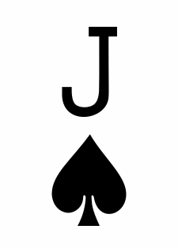
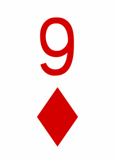
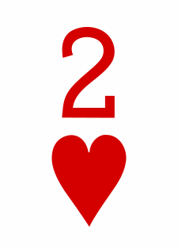
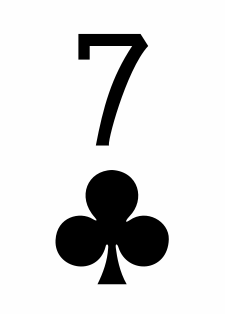
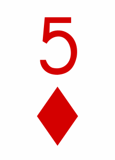
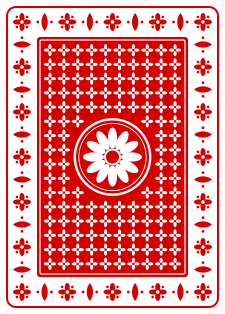
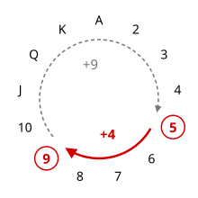

# Fitch Cheney's Five Card Trick

Learn Fitch Cheney's five-card trick, then see how fast you can do the magician's part. Play it at [thrysoee.dk/fivecardtrick/](https://thrysoee.dk/fivecardtrick/).

## The trick

A volunteer picks five cards from a shuffled deck and hands them to the assistant.

<p>





</p>

The assistant hides one card and lays the other four in a row.

<p>



</p>

The magician looks at the row and names the hidden card, the 9 of diamonds. Nothing else passes between them. In the 1950 original the magician isn't even in the room, and someone reads the four cards out over the telephone. How does the magician know?

## The assistant encodes

1. **Find two of a suit.** Here ♦5 and ♦9.
2. **Choose which to hide.** Put the 13 ranks on a clock. Going clockwise, 5 to 9 is 4 steps and 9 to 5 is 9 steps. The two ways round always add up to 13, so one of them is 6 steps or fewer. Hide the card at the end of the short way, ♦9, and lay the other, ♦5, first.

   

3. **Rank the other three.** A is lowest and K highest. Equal ranks go by suit, ♣ < ♦ < ♥ < ♠. Here ♥2 is Low, ♣7 Middle and ♠J High.
4. **Order them to show the number.** Each order of Low, Middle and High stands for a number:

    ```
    LMH 1   LHM 2
    MLH 3   MHL 4
    HLM 5   HML 6
    ```

    Codes starting with L are 1 or 2, M 3 or 4, H 5 or 6. If the last two cards go up, take the smaller number. To show 4, lay them MHL: ♣7 ♠J ♥2.

## The magician decodes

1. The first face-up card gives the suit, ♦.
2. The order of the other three gives the steps. ♣7 ♠J ♥2 is MHL, which is 4.
3. Count that many steps forward from the first face-up card. After K comes A.

The game writes each hand out like this:

```
♦5 ♣7 ♠J ♥2 = ♦5 + MHL = ♦5 + 4 = ♦9
♠Q ♦8 ♥3 ♣K = ♠Q + MLH = ♠Q + 3 = ♠2
```

In the second hand, three steps from Q go K, A, 2.

## Why it always works

- There are five cards and only four suits, so two always share a suit. If more do, the assistant can use any two of them.
- Two ranks on a 13-step clock are never more than 6 steps apart going the short way.
- Three cards can be laid out in 3 × 2 × 1 = 6 orders, one for each distance from 1 to 6.

## The game

You are the magician. The game deals the cards and plays the assistant.

- Name the hidden card as fast as you can. Ten correct hands in a row wins, and one mistake ends the game.
- Your score is the average time per hand. The browser remembers your best score.
- Space deals the next hand. A, 2 to 9, 0 (for 10), J, Q and K answer.
- The results table shows each hand worked out as above, so you can see where a mistake came from.

## Credit

The trick is by William Fitch Cheney Jr., a mathematics professor at the University of Connecticut. It was first published as ["Telephone Stud"](https://babel.hathitrust.org/cgi/pt?id=mdp.39015016358890&seq=65) in Wallace Lee's _Math Miracles_ (1950). Lee's version uses a different code for the other three cards and puts the same-suit card last.
